# Gully Cricket Score

A cricket scoring app I built for our street (gully) matches. One person scores ball by ball on their phone, and everyone else can watch the match live on theirs, just by scanning a QR code.

I'm learning DevOps, so I wanted a project that real people would actually use. The app is the fun part. The pipeline behind it (GitHub Actions, GitHub Pages, Firebase, a Capacitor Android build) is where I learned the most.

**Try it:** https://manyamtharun23-lang.github.io/gully-cricket/

<p align="center">
  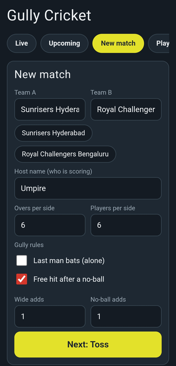
  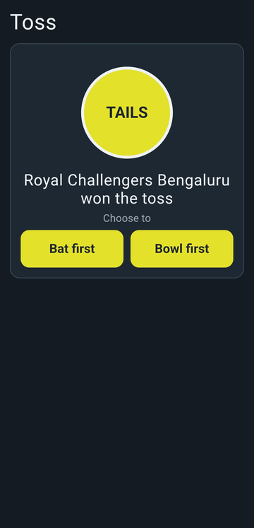
  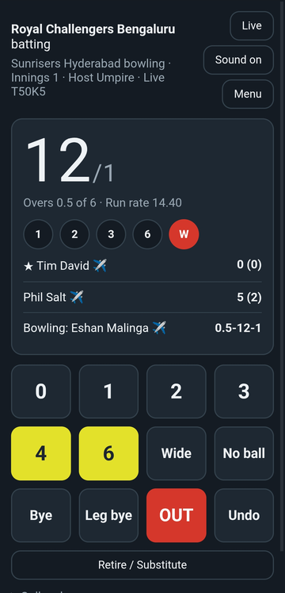
  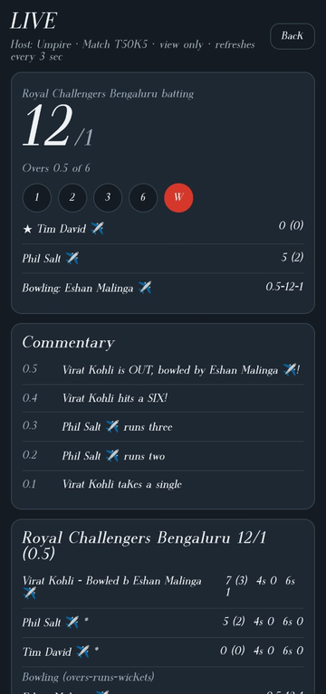
</p>

## What it does

**Scoring**
- Ball-by-ball scoring with 0 to 6 runs, wides, no-balls (with an optional free hit), byes and leg byes
- Wicket types: bowled, caught, LBW, stumped, hit wicket, run out (who is out, and how many runs were completed)
- Retire a batsman, or change the bowler mid-over, for the friend who has to leave early
- Last man bats, if that's how your gully plays
- A toss built into the app. Nobody carries a coin these days.
- Super over when the scores are tied
- Undo, commentary, over-by-over summary, Man of the Match
- Sounds for fours, sixes and wickets, and the phone stays awake while you score

**Live sharing**
- Every match gets a Match ID, a QR code and a watch link as soon as the toss is done
- Viewers see the score, the current over, the scorecard and live commentary. They can only watch.
- Scoring from another phone needs the Match ID and a 4-digit scorer PIN
- Matches can be scheduled in advance. Only the phone that scheduled one can start it.

**Players and history**
- Optional login with email and password, and a player profile (role, batting hand, bowling style)
- Stats are saved to your profile when a logged-in host finishes a match and your name matches
- Players list, leaderboard (most runs, wickets, sixes), saved teams, past matches with full scorecards
- Share a scorecard as text or as an image

<p align="center">
  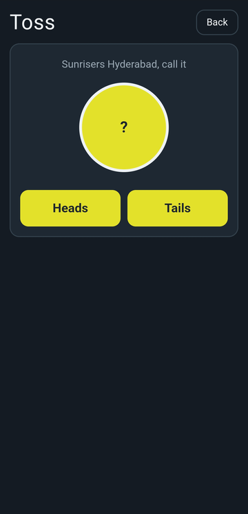
  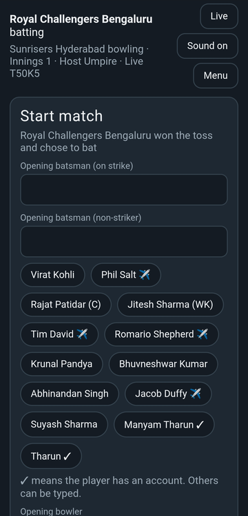
  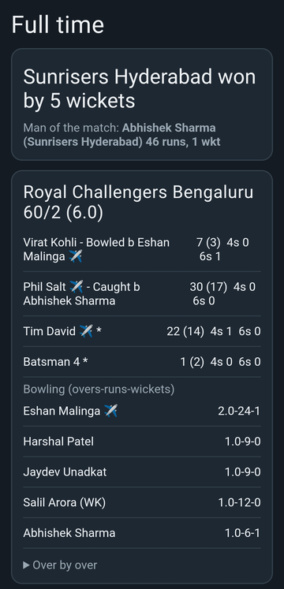
  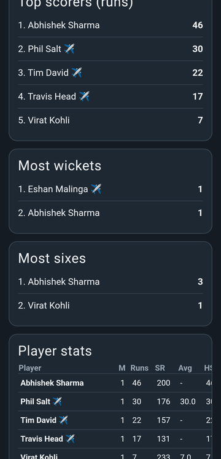
</p>

## How it's built

| Part | What I used |
|---|---|
| App | One `index.html` file, vanilla JavaScript, no framework |
| Live scores, login, stats | Google Firebase (Realtime Database and Authentication), called over plain REST with `fetch` |
| Hosting | GitHub Pages, plus Firebase Hosting for the live and QR links |
| Android app | Capacitor. The APK simply opens the hosted website. |
| CI/CD | GitHub Actions |

### How a push reaches every phone

<p align="center">
  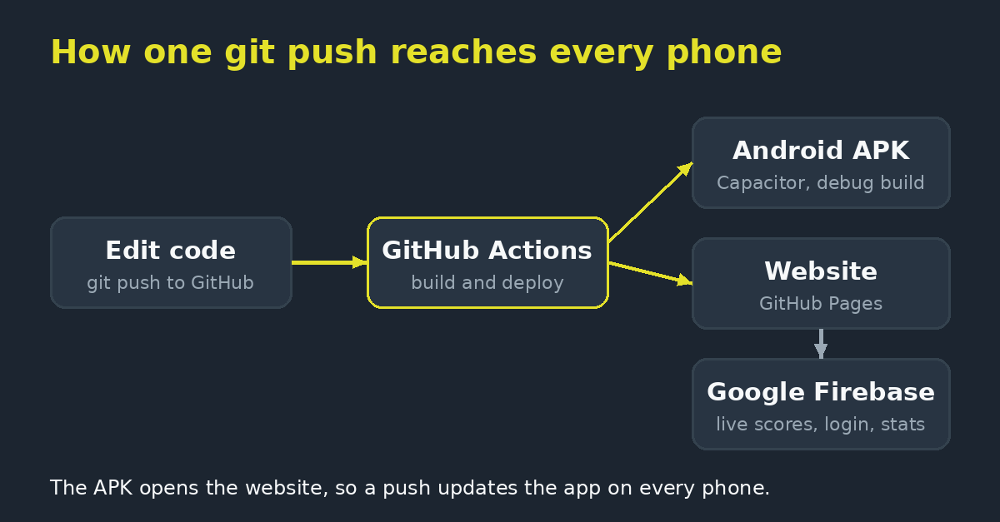
</p>

1. I edit `www/index.html` and `git push`.
2. **GitHub Actions** deploys the website to GitHub Pages (`pages.yml`).
3. The same push can build the Android APK (`build-apk.yml`): Node 20, Java 17, Capacitor, Gradle. The APK is uploaded as an artifact, and attached to a Release when I push a tag like `v1.0.1`.
4. The APK opens the website, so friends get the new version the next time they open the app. I only rebuild the APK when something native changes, like the icon or app name.
5. Firebase Hosting is still deployed by hand with `firebase deploy --only hosting`. Putting that in the pipeline is on my list.

### How the live part works

- The scoring phone saves the whole match as JSON to `/live/<MATCH_ID>` in the Realtime Database after every ball.
- A small summary goes to `/live_index/<MATCH_ID>`, which feeds the "Ongoing matches" list.
- Viewers open `?c=<MATCH_ID>` and the page fetches the match every 3 seconds. It has no scoring buttons.
- The scorer PIN is stored only as a hash. The PIN itself never leaves the host's phone.

<p align="center">
  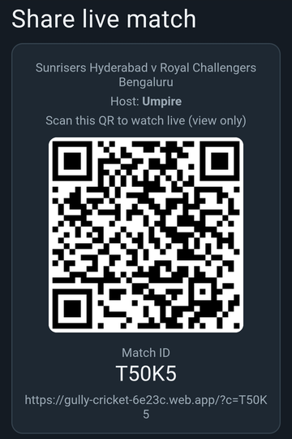
  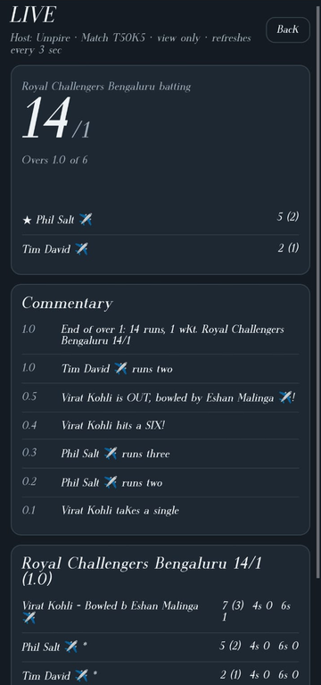
</p>

## Project structure

```
.
├── www/
│   ├── index.html          the whole app
│   ├── sw.js               service worker (offline support)
│   └── sounds/             mp3 sound effects
├── assets/                 app icon sources for the Android build
├── capacitor.config.json   Android wrapper, points at the hosted site
├── package.json
├── firebase.json           Firebase Hosting config (public dir: www)
└── .github/workflows/
    ├── pages.yml           deploys www/ to GitHub Pages
    └── build-apk.yml       builds the debug APK
```

## Run your own copy

1. **Fork or clone** this repo.
2. **Create a Firebase project** and turn on:
   - Realtime Database
   - Authentication, with the Email/Password provider
3. **Add a Web app** in Firebase (Project settings, General, Your apps). Copy its `apiKey`. This key is not a secret.
4. In `www/index.html`, set these constants near the top of the script:
   - `FBKEY` to your Web API key
   - `DB` to your Realtime Database URL
   - `LIVE_URL` to the URL where you host the app
5. **Database rules.** Publish these in the Realtime Database, Rules tab:

```json
{
  "rules": {
    "live": { ".read": false, "$code": { ".read": true, ".write": true } },
    "live_index": { ".read": true, ".write": true, ".indexOn": ["ts"] },
    "upcoming": { ".read": true, ".write": true, ".indexOn": ["at"] },
    "profiles": { ".read": true, "$uid": { ".write": "auth != null && auth.uid === $uid" } },
    "stats": { ".read": true, "$uid": { "m": { "$mid": { ".write": "auth != null" } } } }
  }
}
```

6. **Turn on GitHub Pages** in the repo settings and choose "GitHub Actions" as the source. Push to `main` and the site deploys.
7. **Android APK (optional).** In `capacitor.config.json`, set `server.url` to your site, then run the "Build APK" workflow from the Actions tab. Download the APK from the run's artifacts.

To try it locally without deploying anything, serve the folder with any static server, for example `python3 -m http.server --directory www 8080`.

## Honest limitations

- **The scorer PIN is checked in the app, not by the database.** It keeps friends from accidentally scoring someone else's match, but it is not real security. Anyone who can write to the database directly could change a score. Properly locking this down needs rules based on `auth.uid`, and that would change how resuming on another phone works.
- **Anyone with the site link can create an account.** There is no invite list yet.
- **Viewer polling is simple, not efficient.** Each viewer downloads the full match JSON every 3 seconds. That is fine for a group of friends, but it would eat through the free Firebase quota with a big crowd. Streaming only the changes is the obvious fix.
- The QR code library loads from a CDN, so the QR does not render offline.
- Stats only link to a profile when the typed player name matches the profile name.
- The APK is a debug build, so Android shows an "unsafe app" warning when installing it.

## What went wrong along the way

I kept the list, because these are the things I now know:

- My first Actions run failed in 12 seconds. I had asked npm to cache dependencies, but the repo had no lockfile.
- GitHub rejected my push because my personal access token did not have the `workflow` scope.
- The site showed a 404 because my file had been saved as `index (2).html`.
- After an update, my phone kept showing the old version. It was the service worker and hosting caches, not my code.
- Firebase Hosting was a version behind GitHub Pages for a while, because I deploy it by hand.

## What's next

- Deploy Firebase Hosting from the pipeline
- Automated tests for the scoring logic, so a broken change never gets deployed
- Version and commit shown in the app footer
- Send only changes to viewers instead of the full match every 3 seconds
- Required run rate, fall of wickets, partnerships and a run-rate graph
- Tournament mode with a points table
- A signed release APK, with the keystore kept in GitHub Secrets

## About

Built by Manyam Tharun while learning DevOps. If you work in DevOps and have thoughts on what this pipeline needs next, I'd love to hear them.
